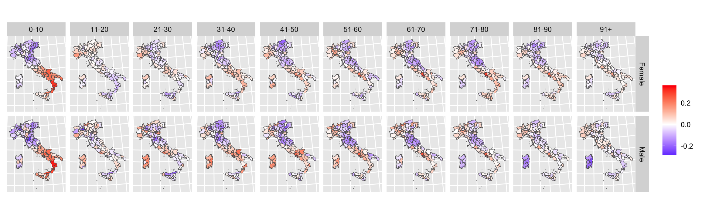

```{r setup}
#| include: false

knitr::opts_chunk$set(echo = FALSE,  
                      message=FALSE, 
                      warning=FALSE, 
                      strip.white=TRUE, 
                      prompt=FALSE,
                      fig.align="center",
                       out.width = "60%")

library(knitr)    # For knitting document and include_graphics function
library(ggplot2)  # For plotting
library(png) 
library(tidyverse)
library(INLA)
library(BAS)
library(patchwork)
library(inlabru)
library(fmesher)

```

## Non linear predictor

In all the models we have seen
$$
\eta = \text{linear function}(\text{components})
$$

- Sometimes one is interested in models whose parameters interact in a non-linear way

. . .

- A simple growth model
- Lee-Carter Model
- Under-reported counts

# A simple growth model

## A simple growth model {.smaller}

We want to include some "biology" in the statistical model.

The age and size of a fish have the following relationship

$$
\begin{aligned}
y_t&\sim\mathcal{N}(\mu_t, \sigma^2)\\
\eta_t &= \mu_t = L(1-\exp(-k\ (t-t_0)))
\end{aligned}
$$ where $t$ is the age and $y_t$ the length of the fish

Parameters are $\theta = c(L,\kappa, t_0)$

```{r}
#| eval: true
#| echo: false

L <- 250
kappa <- 0.39
t0 <- -2
sd_y <- 1

Ndata <- 1000
max_age <- 10


df0 <- data.frame(age = seq(0,max_age, 0.1)) %>%
  mutate(mu = L * (1 - exp(-kappa * (age - t0)))) 


df <- data.frame(age = runif(n = Ndata, min = 0, max = max_age)) %>%
  mutate(mu = L * (1 - exp(-kappa * (age - t0)))) %>%
  mutate(y = rnorm(Ndata, mu, sd_y))


df0 %>% ggplot() + geom_line(aes(age, mu)) +
  ylab("Mean size")
```

## Model Parameters and Priors {.smaller}

The parameters have a biological meaning and we need to assign them a prior distribution:

<!-- cmp <- ~ -1 + -->

<!--   L(1, prec.linear = 1, marginal = bm_marginal(qexp, rate = scale_par / 300)) + -->

<!--   kappa(1, prec.linear = 1, marginal = bm_marginal(qexp, rate = 2)) + -->

<!--   t0(1, -1, prec.linear = 1, marginal = bm_marginal(qexp, rate = 1)) -->

- $L$ is the the **maximum average length** that fish approach as they become very old.

$$L\sim\text{exp}(1/300)$$ In the prior $\mathbb{E}(L) = 300$, $\text{sd}(L) = 300$

- $k$ is the the **growth rate** (how fast the fish grows)

$$k\sim\text{exp}(2)$$ 

- $t_0$ is the the **hypothetical age at zero length**

$$t_0\sim\text{exp}(1)$$

## A simple growth model - Noisy Observations {.smaller}

The age and size of a fish have the following relationship

$$
\begin{aligned}
y_t&\sim\mathcal{N}(\mu_t, \sigma^2)\\
\eta_t &= \mu_t = L(1-\exp(-k\ (t-t_0)))
\end{aligned}
$$

where $t$ is the age and $y_t$ the length of the fish

```{r}
#| eval: true
#| echo: false


df0 %>% ggplot() + geom_line(aes(age, mu)) +
  ylab("Mean size") +
  geom_point(data =df, aes(age, y), color = "red")
```

## A simple growth model

### Why do we need more than INLA?

$$
\begin{aligned}
y_t&\sim\mathcal{N}(\mu_t, \sigma^2)\\
\eta_t &= \mu_t = L(1-\exp(-k\ (t-t_0)))
\end{aligned}
$$

**Note** This model cannot be solved in INLA...why?

:::{.fragment}

The model components $L$, $k$, $t_0$ enter the predictor $\eta$ in a non-linear way.

:::

:::{.fragment}

This means that $\eta$ is **NOT** Gaussian!!

:::

## Extending INLA to non-linear predictors {.smaller}

::: smaller
In addition to being a wrapper around R-INLA, `inlabru` extends the scope of INLA to models with non-linear predictors $\tilde{\eta}(\mathbf{u})$.
:::

. . .

::::::: columns
:::: {.column width="70%"}
::: smaller
:bulb: **The idea** :bulb:

- Linearize $\tilde{\eta}(\mathbf{u})$ using a first-order Taylor expansion around $\mathbf{u}_0$:

$$
\tilde{\eta}(\mathbf{u}) \approx \tilde{\eta}(\mathbf{u}_0) + f_{\text{linear}}(\mathbf{u}) = \bar{\eta}(\mathbf{u})
$$

- Run INLA for the linearized problem\
- Iterate until convergence
  - $\tilde{\eta}(\mathbf{u}_0)$ close enough to $\bar{\eta}(\mathbf{u_0})$
:::
::::

:::: {.column width="30%"}
::: {.callout-note .smaller}
**Note**

For details:\
<https://arxiv.org/abs/2407.00791v1>
:::
::::
:::::::

## Extending INLA to non-linear predictors

- The linearization is an approximation on top of the "usual" INLA approximation
- Accuracy will depend on the nature of the non-linearity around $\mathbf{u}_0$ and the choice of convergence criteria.
- Greater care than usual is needed for the choice of priors.


. . .

Some checks are possible (see the arxive paper)...

**BUT** this method is still in an "experimental" mode, so great care is needed!


## A simple growth model - Fitting the model {.smaller}

$$
\begin{align}
y_t &\sim\mathcal{N}(\eta_t,\sigma^2)\\
\eta_t &= L(1-\exp(-k(t-t_0)))\\
L &\sim\exp(1/300); \qquad k \sim\exp(2);\qquad t_0\sim\exp(1)
\end{align}
$$

```{r}
#| eval: false
#| echo: true
#| message: false
#| code-line-numbers: "1-2"
#| 
scale_par <- sd(df$y)
df <- df %>% mutate(y_scale = y / scale_par)

cmp <- ~ -1 +
  L(1, prec.linear = 1, marginal = bm_marginal(qexp, rate = scale_par / 300)) +
  kappa(1, prec.linear = 1, marginal = bm_marginal(qexp, rate = 2)) +
  t0(1, -1, prec.linear = 1, marginal = bm_marginal(qexp, rate = 1))

growth_function <- function(L, kappa, t0, age) {
  L * (1 - exp(-kappa * (age - t0)))
}

formula <- y ~  growth_function(L, kappa, t0, age)

lik <- bru_obs(
  formula = formula,
  family = "gaussian",
  data = df
)
bru_options_set(bru_verbose = 1, bru_max_iter = 20)
fit <- bru(cmp, lik)
```

- Scale the data (always a good practice to avoid numerical problems)

## A simple growth model - Fitting the model {.smaller}

$$
\begin{align}
y_t &\sim\mathcal{N}(\eta_t,\sigma^2)\\
\eta_t &= L(1-\exp(-k(t-t_0)))\\
L &\sim\exp(1/300); \qquad k \sim\exp(2);\qquad t_0\sim\exp(1)
\end{align}
$$

```{r}
#| eval: false
#| echo: true
#| message: false
#| code-line-numbers: "3-7"


scale_par <- sd(df$y)
df <- df %>% mutate(y_scale = y / scale_par)

cmp <- ~ -1 +
  L(1, prec.linear = 1, marginal = bm_marginal(qexp, rate = scale_par / 300)) +
  kappa(1, prec.linear = 1, marginal = bm_marginal(qexp, rate = 2)) +
  t0(1, -1, prec.linear = 1, marginal = bm_marginal(qexp, rate = 1))

growth_function <- function(L, kappa, t0, age) {
  L * (1 - exp(-kappa * (age - t0)))
}

formula <- y ~  growth_function(L, kappa, t0, age)

lik <- bru_obs(
  formula = formula,
  family = "gaussian",
  data = df
)
bru_options_set(bru_verbose = 1, bru_max_iter = 20)
fit <- bru(cmp, lik)
```

- Define the components

**Note** here we use the PIT transform to go from $\mathcal{N}(0,1)$ to $\exp(\kappa)$

This also gives a non-linear model, this "trick" can be useful in other cases!!

## A simple growth model - Fitting the model {.smaller}

$$
\begin{align}
y_t &\sim\mathcal{N}(\eta_t,\sigma^2)\\
\eta_t &= L(1-\exp(-k(t-t_0)))\\
L &\sim\exp(1/300); \qquad k \sim\exp(2);\qquad t_0\sim\exp(1)
\end{align}
$$

```{r}
#| eval: false
#| echo: true
#| message: false
#| code-line-numbers: "9-13"
#| 
scale_par <- sd(df$y)
df <- df %>% mutate(y_scale = y / scale_par)

cmp <- ~ -1 +
  L(1, prec.linear = 1, marginal = bm_marginal(qexp, rate = scale_par / 300)) +
  kappa(1, prec.linear = 1, marginal = bm_marginal(qexp, rate = 2)) +
  t0(1, -1, prec.linear = 1, marginal = bm_marginal(qexp, rate = 1))

growth_function <- function(L, kappa, t0, age) {
  L * (1 - exp(-kappa * (age - t0)))
}

formula <- y ~  growth_function(L, kappa, t0, age)

lik <- bru_obs(
  formula = formula,
  family = "gaussian",
  data = df
)
bru_options_set(bru_verbose = 1, bru_max_iter = 20)
fit <- bru(cmp, lik)
```

- Define the non-linear function of the paramters and the formula

## A simple growth model - Fitting the model {.smaller}

$$
\begin{align}
y_t &\sim\mathcal{N}(\eta_t,\sigma^2)\\
\eta_t &= L(1-\exp(-k(t-t_0)))\\
L &\sim\exp(1/300); \qquad k \sim\exp(2);\qquad t_0\sim\exp(1)
\end{align}
$$

```{r}
#| eval: false
#| echo: true
#| message: false
#| code-line-numbers: "15-22"
#| 
scale_par <- sd(df$y)
df <- df %>% mutate(y_scale = y / scale_par)

cmp <- ~ -1 +
  L(1, prec.linear = 1, marginal = bm_marginal(qexp, rate = scale_par / 300)) +
  kappa(1, prec.linear = 1, marginal = bm_marginal(qexp, rate = 2)) +
  t0(1, -1, prec.linear = 1, marginal = bm_marginal(qexp, rate = 1))

growth_function <- function(L, kappa, t0, age) {
  L * (1 - exp(-kappa * (age - t0)))
}

formula <- y ~  growth_function(L, kappa, t0, age)

lik <- bru_obs(
  formula = formula,
  family = "gaussian",
  data = df
)
bru_options_set(bru_verbose = 1, bru_max_iter = 20)
fit <- bru(cmp, lik)
```

- Define the likelihood and the run the model as usual

**NOTE** the `bru_options_set(bru_verbose = 1, bru_max_iter = 20)` is a way to get some info out of the `bru()` function

## Check iterations

```{r}
#| eval: true
#| echo: false
#| message: true
scale_par <- sd(df$y)
df <- df %>%
  mutate(y_scale = y / scale_par)
# define components -------------------------------------------------------

# L ~ Exp(1/300), expectation = 300
# kappa ~ Exp(2), expectation = 1/2
# t0 ~ nearly flat prior, N(0, 30^2), "+ t0(1)" works, but not ideal.
# The model description say t0 must be negative, which should be encoded with a
# prior, which is done below, by scaling an Exp(1) model with "-1".
cmp <- ~ -1 +
  L(1, prec.linear = 1, marginal = bm_marginal(qexp, rate = scale_par / 300)) +
  kappa(1, prec.linear = 1, marginal = bm_marginal(qexp, rate = 2)) +
  t0(1, -1, prec.linear = 1, marginal = bm_marginal(qexp, rate = 1))

growth_function <- function(L, kappa, t0, age) {
  L * (1 - exp(-kappa * (age - t0)))
}

formula <- y_scale ~  growth_function(L, kappa, t0, age)

lik <- bru_obs(
  formula = formula,
  family = "gaussian",
  data = df
)
bru_options_set(bru_verbose = 1, bru_max_iter = 20)
fit <- bru(cmp, lik)


```

## Checking results - Estimated parameters

```{r}
#| code-fold: true
#| echo: true

samples <- generate(fit,
  formula = ~ data.frame(
    L = L * scale_par,
    t0 = t0,
    kappa = kappa,
    sd_y = scale_par / sqrt(Precision_for_the_Gaussian_observations)
  ),
  n.samples = 1000
)
samples <- do.call(rbind, lapply(samples, as.data.frame))


p1 <- ggplot(samples) +
  geom_density(aes(L)) +
  geom_vline(xintercept = L) +
  xlab("") +
  ylab("") +
  ggtitle("L")
p2 <- ggplot(samples) +
  geom_density(aes(t0)) +
  geom_vline(xintercept = t0) +
  xlab("") +
  ylab("") +
  ggtitle("t0")
p3 <- ggplot(samples) +
  geom_density(aes(kappa)) +
  geom_vline(xintercept = kappa) +
  xlab("") +
  ylab("") +
  ggtitle("kappa")
p4 <- ggplot(samples) +
  geom_density(aes(sd_y), adjust = 3) +
  geom_vline(xintercept = sd_y) +
  xlab("") +
  ylab("") +
  ggtitle("sd_y")

p1 + p2 + p3 + p4 + plot_layout(ncol = 2) + plot_annotation(title = "Estimated parameters")


```

# Lee-Carter Model

## A (Bayesian) spatial extension of the Lee-Carter model {.smaller}

$$\begin{align*}
Y_{xt} \mid \lambda_{xt} &\sim \text{Poisson}(E_{xt} \lambda_{xt})\\
\log(\lambda_{xts}) &= \alpha_x + \beta_x \kappa_t + \omega_{sg_x} +  z_{xts}
\end{align*}
$$ with

- $\alpha_x \mid \tau_\alpha \sim \mathcal{N}(0, \tau_\alpha)$, for $x=1, \ldots, N$.
- $\beta_x \mid \tau_\beta \sim \mathcal{N}(0, \tau_\beta)$, for $x=1, \ldots, N$, with $\sum_x \beta_x = 1$
- $\kappa_t = \phi \cdot t  + \kappa^\star_{t}$, $t=1, \ldots, T$, where ${\kappa}^\star$ follows a RW1($\tau_\kappa$) and $\sum \kappa_t = 0$
- $\omega_{sg_x} \mid \tau_\omega$ Age specific spatial effect
- $z_{xts} \mid \tau_z$ iid effect to allow for extra variability

:::{.fragment}

See [this paper](https://link.springer.com/article/10.1007/s40980-026-00161-x) for further details.

Code and simulated data available [here](https://github.com/smar-git/Mortality_Italy)

:::


## Identifiability Constraints

Model is not unique:

$$\alpha_x + \beta_x \kappa_t = \alpha_x + (c \beta_x)(\kappa_t / c)$$

So we impose constraints:

- $\sum_t \kappa_t = 0$
- $\sum_x \beta_x = 1$

:point_right: Ensures unique interpretation of parameters

## `inlabru` implementation

```{r}
#| echo: true
#| eval: false

cmp_model1 = ~ -1 +
  alpha(age,model= "iid", constr =  F,)+
  beta(age, model= "iid", extraconstr = list(A=A, e=e))+
  kappa(time, model= "rw2", constr = T) +
  spatial(space,  model = "bym2",
          graph = Q_space,
          replicate = as.numeric(as.factor(age2)),
          nrep = length(unique(df$age2))) +
  random(rand2, model = "iid")


formula_model = Y ~    Intercept  +  alpha +
  beta * kappa +  spatial + random

likelihood = bru_obs(formula = formula_model,
                      family = "poisson",
                      data = df ,
                      E = E)
result_model = bru(components = cmp_model, likelihood)

```

$$
\log(\lambda_{xts}) = \alpha_x + \beta_x \kappa_t + \omega_{sg_x} +  z_{xts}
$$ 

## Results




# Accounting for underreporting

## Model for underreported counts {.smaller}

The true (unobserved ) counts
$$
\begin{align}
Y^*_i & \sim \text{Poisson}(E_i\lambda_i)\\
\log(\lambda_i) & = \beta_0 + \beta_1x_i + u_i
\end{align}
$$

. . . 


The thinned (observed ) counts

$$
\begin{aligned}
Y_i & \sim \text{Poisson}(E_i\lambda_i\pi_i)\\
\log(\lambda_i) & = \beta_0 + \beta_1x_i + u_i\\
\text{logit}(\pi_i)& = \alpha_0 + \alpha_1z_i\\
\end{aligned}
$$

. . .


The non-linear predictor

$$
\begin{align}
Y_i & \sim \text{Poisson}(E_i\lambda_i\pi_i)\\
\eta_i & = \log(\lambda_i\pi_i)  \\
&  = \beta_0 + \beta_1x_i + u_i + \log(\text{inv.logit}(\alpha_0 + \alpha_1z_i))
\end{align}
$$

## `inlabru` implementation


```{r}
#| echo: true
#| eval: false


func_probs = function(v,alpha0,alpha1)
{
  aa = alpha0 + alpha1 * v
  return(-log(1+exp(-aa)))
}


cmp =  ~  -1 + 
  beta_0(main = 1, model = "linear") +
  beta_1(main = covariate_x, model = "linear")+
  spatial(loc, model = "besag", graph = Q) +

  alpha_0(main = 1, model = "linear",
        mean.linear = b0_mean,
        prec.linear = 1/(b0_sd)^2) +
  alpha_1(main = 1, model = "linear") 
  

formula =  Y_obs  ~  
  beta_0 + beta_1 + spatial + 
  func(covariate_z, b0, b1)

lik1 = bru_obs("poisson",
            formula = formula,
            data= df, 
            E = E)


fit1 <- bru(cmp, lik)
          
```


**NOTE** we have (quite) informative priors for $\alpha_0$


## Final Notes

- Be careful when using this models!!!

- Think carefully if the model makes sense

- Think carefully about priors

- Check the convergence 
```{r}
#| echo: true
#| eval: false

bru_options_set(bru_verbose = 2)
```


