```{r setup}
#| include: false
#| eval: false


knitr::opts_chunk$set(echo = FALSE,  
                      message=FALSE, 
                      warning=FALSE, 
                      strip.white=TRUE, 
                      prompt=FALSE,
                      fig.align="center",
                       out.width = "60%")

library(knitr)    # For knitting document and include_graphics function
library(ggplot2)  # For plotting
library(png) 
library(tidyverse)
library(INLA)
library(BAS)
library(patchwork)
library(inlabru)

```

## What we have discusssed in this course{.smaller}

- General principles of INLA and `inlabru`
- Temporal Models
- Spatial Models
  - Areal Data
  - Geostatistical Data
  - Point Processes
- Spatio-temporal Models
- Multi-likelihood Models
- Comparing and Evaluating Models

. . .

INLA and `inlabru` are still evolving, a lot of other things are available (at different levels of maturity!)


## Other topics one could be interested in{.smaller}

- Covariates with effect that changes in space and/or time
- Observing aggregated quantities
- Modeling non-stationarity
  - Barrier Model
  - Using covariates in the covariance structure
- More complex spatial and spatio-temporal models
  - Non-separable spatio-temporal models
  - Fractional SPDE model
- Modeling spatial dependences on different domains
- Other 
  - Distance sampling 
  - Modeling Animal movement data
  - Self-exciting Hawks processes

# Space/time varying covariate effects

## Space/time varying covariate effects

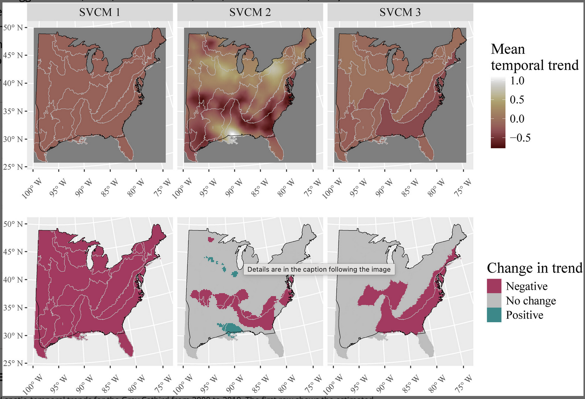{fig-align="center"}


## Space/time varying covariate effects

The model

$$
\eta(s) = \beta_0 + \beta_1(s)\ x(s)
$$

Implementation

```{r}
#| echo: true
#| eval: false

cmp = ~ Intercept(0) + space_beta(geometry, weights = covariate, model = spde)

# OR

cmp = ~ Intercept(0) + space_beta(idx_region, weights = covariate, model = "besag")

```


## Some relevant references


- Vignette on the [inlabru website](https://inlabru-org.github.io/inlabru/articles/svc.html)


::: {style = "font-size: 0.7em;" .refs-subset data-keys="@belmont2024spatio"}
:::


# Observing aggregated quantities

## Observing aggregated quantities{.smaller}
Sometimes we do not observe our quantity of interest directly

. . .


:::: {.columns}

::: {.column width="60%"}
We have emissions at NUTS2 level, want to downscale at NUTS3

- At NUTS3 (unobserved)
  - $y_i \sim\mathcal{N}(\mu_i,\sigma^2)$
  - $\mu_i = \beta_0 + \beta_1x_i+u_i$

- At NUTS2 (observed data)

  - $Z_j = \sum_{i\in A_j}y_i\sim\mathcal{N}(m_j,\sigma^2_j)$

  - $m_j = \sum_{i\in A_j}(\beta_0 + \beta_1x_i+u_i)$ and $\sigma^2_j\approx\frac{\sigma^2}{N_j} $

  
:::


::: {.column width="40%"}
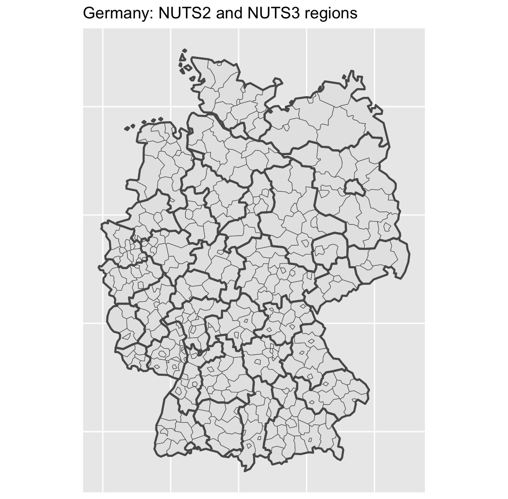{width=100%}
:::

::::


## Observing aggregated quantities

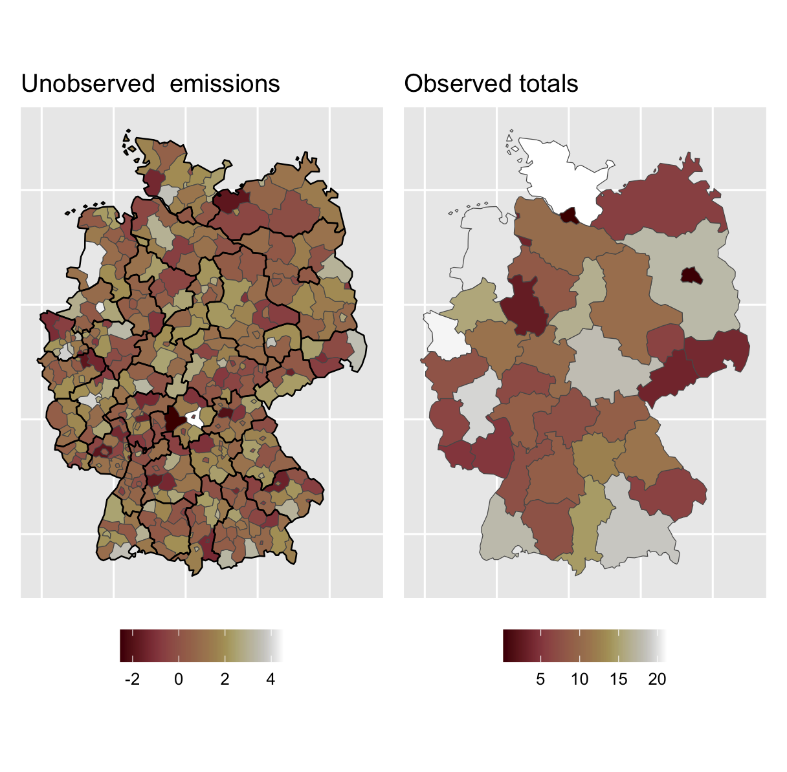


## Observing aggregated quantities
Model set-up

```{r}
#| eval: false
#| echo: true

cmp <- ~ 0 + beta(1, prec.linear = 1) +
  space(main = space, model = "besag",
        graph = INLA::inla.matrix2graph(Q),
        scale.model = T) +
  covariate(cov, model= "linear")

mapper1 <- bm_aggregate(rescale = FALSE,n_block = max(nuts3$block))

formula1 = y2 ~ ibm_eval(mapper1,
                        input = list(block = block, weights = weight),
                        state = beta + space  + covariate)

# Construct the likelihood
lik1 <- bru_obs(
  formula = formula1,
  scale = 1/data_obs$n_reg,
  data = nuts3 ,
  response_data = data_obs)
```


## Some notes and relevant references


- The aggregation is easy if the likelihood is Gaussian
- It is also easy for Poisson data (but need the non-linear approximation)
- More complicated for other likelihood models

:::{style="margin-top: 2em;"}
:::
::: {style = "font-size: 0.7em;".refs-subset data-keys="@lindgren2024inlabru @wu2026arealdisaggregationsmallarea @villejo2026spatiotemporalblockaggregationmodel "}
:::


# Modeling non-stationarity

## The barrier model - Motivation

Physical barriers (walls, islands, lakes...) have an effect on the phenomenon under study:


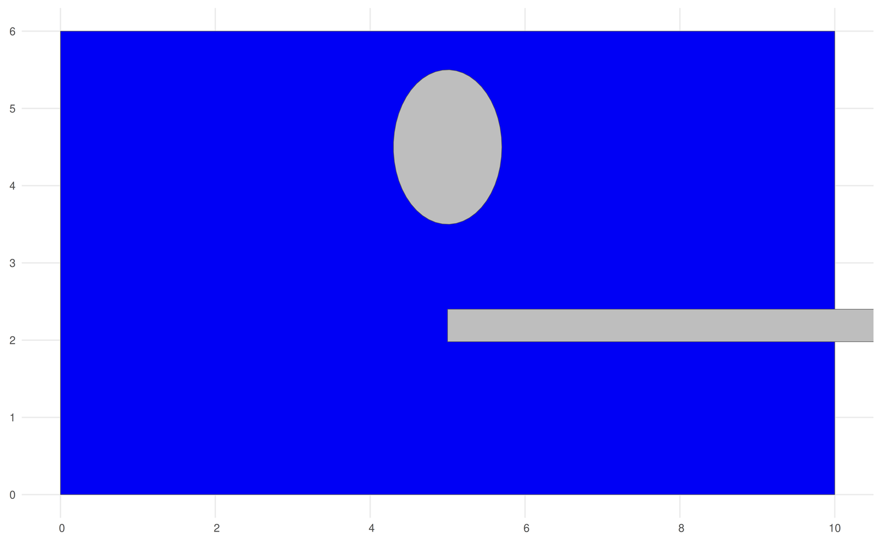

## The barrier model

- Define which mesh nodes are barrier and which are not
- Two different ranges for the two regions types


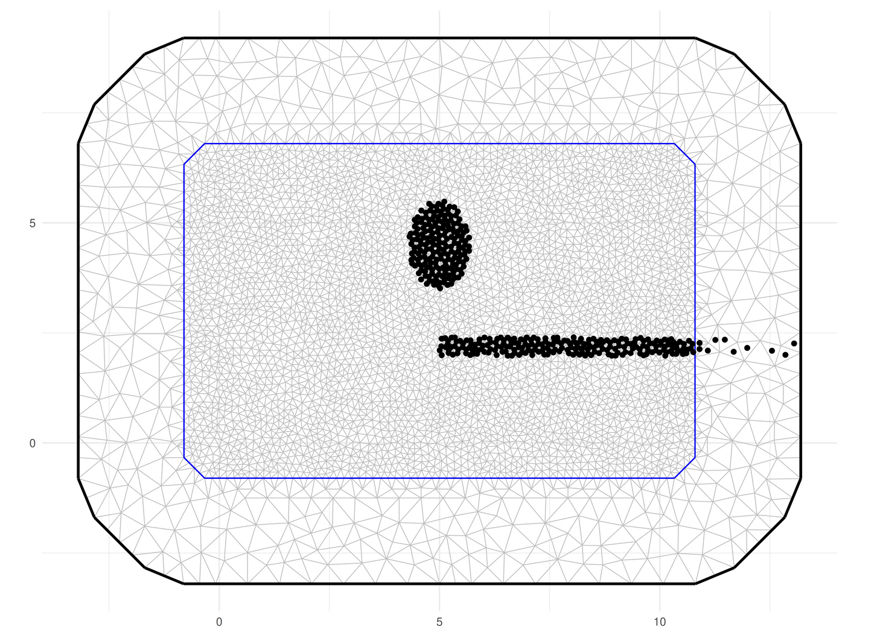


## The barrier model - Results

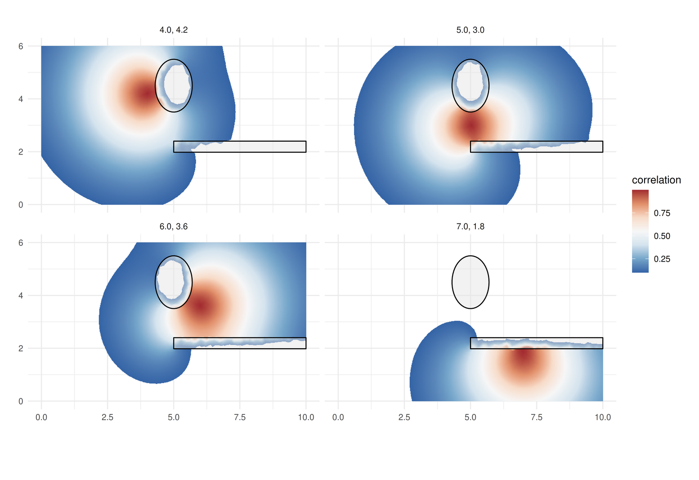

**Note** To make some difference the barrier has to be large enough (more than the range...)


## Barrier Model - some references 


::: {style = "font-size: 0.7em;" .refs-subset data-keys="@bakka2019non  @panunzi2025estimating"}
:::

## Modeling non-stationarity in with covariates

Sometimes we want the covariance to depends not only on the distance but also on the locations.

. . .

The SPDE apporach make it possible to use covariates in the covariance structure

$$
\left(\kappa(s)^2-\Delta\right)\tau(s)u(s) = \mathcal{W}(s)
$$
where we can have
$$
\log\tau(s) = \theta_{\tau,1} + \sum_jb_{\tau,j}\theta_{\tau,j}, \qquad\log\kappa(s) = \theta_{\kappa,1} + \sum_jb_{\kappa,j}\theta_{\kappa,j},
$$

## Modeling non-stationarity in space
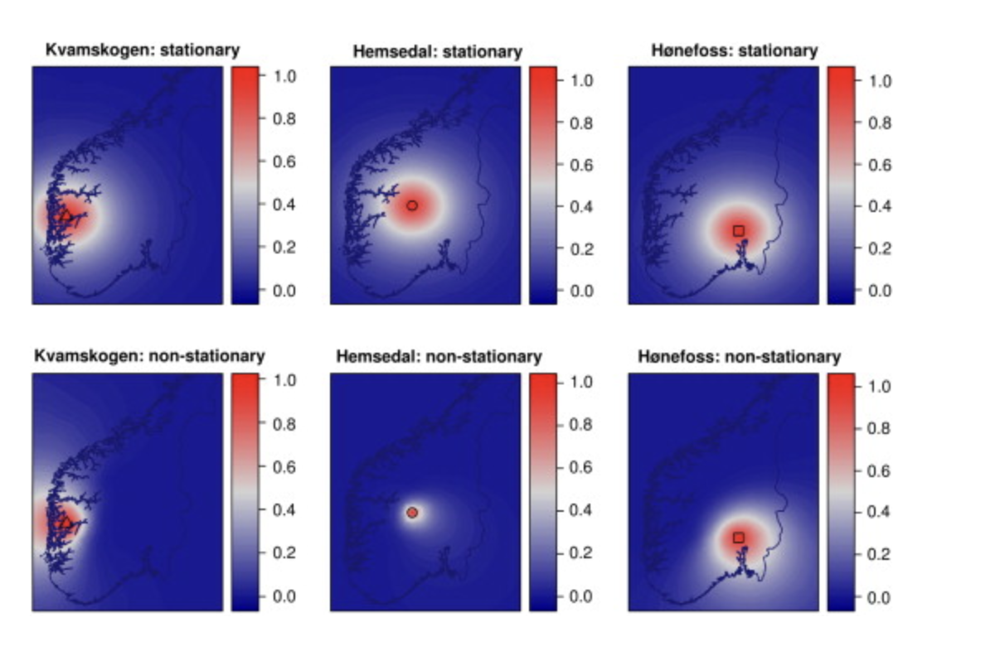

## Modeling non-stationarity in space - some references

Note: A more flexible approach using basis functions instead of covariates is also possible

:::{style = "margin-top: 2em;"}
:::

::: {style = "font-size: 0.7em;" .refs-subset data-keys="@ingebrigtsen2014spatial @ingebrigtsen2015estimation @fuglstad2015exploring @fuglstad2015does"}
:::

# More complex spatial and spatio-temporal models

## Non-separable spatio-temporal models

All the space-time models we have seen are separable:

$$
\text{Cov}\{x(\mathbf{s}_1,t_1),x(\mathbf{s}_2,t_2)\}
=
C_S(\mathbf{s}_1,\mathbf{s}_2)\,
C_T(t_1,t_2).
$$
- Spatial and temporal dependence act independently.
- Implies that the temporal correlation structure is the same at all spatial scales.


**Advantages**

- Easy to specify and compute.
- Easy to interpret

**Disdvantages**

- Can be unrealistic for physical processes where information propagates through space over time (examples: Weather systems moving across a region, Ocean currents, Air pollution transport, Spread of infectious diseases...)


## Non-separable spatio-temporal models

In 


::: {style = "font-size: 0.7em;" .refs-subset data-keys="@Lindgren_Bakka_Bolin_Krainski_Rue_2024"}
:::

a non-separable model for the space-time covariance:

$$
\text{Cov}\{x(\mathbf{s}_1,t_1),x(\mathbf{s}_2,t_2)\},
$$

is defined through a diffusion equation. 

What they get:

- Spatial dependence is represented by a Matérn field.

- Temporal evolution is driven by a diffusion process.

- Information can spread across space as time passes.

- This naturally induces a **non-separable** covariance structure.


[GitHub repo](https://eliaskrainski.github.io/INLAspacetime/) for the project


## Fractional SPDE models

The "basic" SPDE approach solved equations of the kind:
$$
(κ^2−Δ)^βu=𝒲.
$$
for integer values of $2\beta$ and $\beta$ fixed.

. . .

The `rSPDE` package provides efficient approximations when  β is a general fractional power. 
As a result, one can easily do inference and prediction using fractional SPDE models such as
$$
(κ^2−Δ)^βu=𝒲.
$$
In particular, it allows for bayesian inference of all model parameters, including the fractional parameter β.


## Fractional SPDE models


::: {style = "font-size: 0.7em;" .refs-subset data-keys="@Fractional1 @Fractional2"}
:::


:::{style = "margin-top:2em;"}
:::

For more info see the [github repo for this project](https://davidbolin.github.io/rSPDE/)


# Modeling spatial dependences on different domains

## Metric Graph

-   Not all phenomena leave on $\mathcal{R}^2$

-   Example: Traffic on roads, fishes in a river, etc...

::::: columns
::: {.column width="50%"}
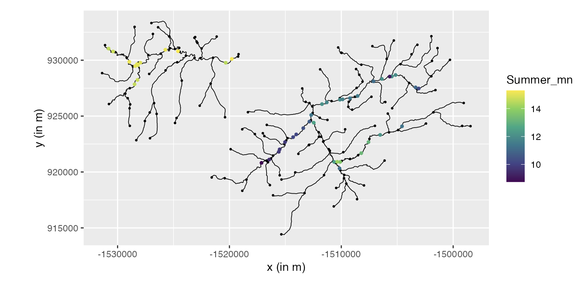
:::

::: {.column width="50%"}
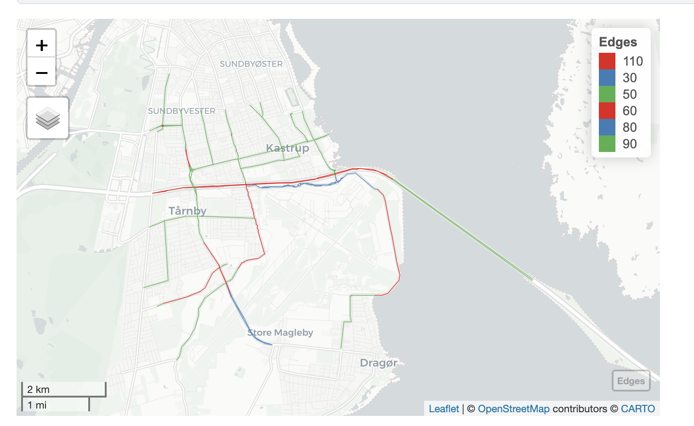
:::
:::::

. . .

-   What is different from $\mathcal{R}^2$?

## Metric Graph

-   What is different from $\mathcal{R}^2$?

    -   Think about distances on the road network...they often do not correspond to the euclidian distance in $\mathcal{R}^2$

-   The random walk has to account for the shape of the graph

-   ..this is what the [MetricGraph library](https://davidbolin.github.io/MetricGraph/index.html) does

:::{style = "margin-top:2em;"}
:::

::: {style = "font-size: 0.7em;" .refs-subset data-keys="@lilleborge2025joint @recachobayesian @bolin2026log"}
:::

..and many more papers from the group of David Bolin


# Other

## Distance Sampling - Complex observation models {.smaller auto-animate="true" background-color="#FFFFFF"}

::: {style="height: 50px;"}
:::

-   Standard distance sampling approaches specify $g(s)$ as a function that declines with increasing distance
    -   perpendicular distance to the transect line for *line transects*

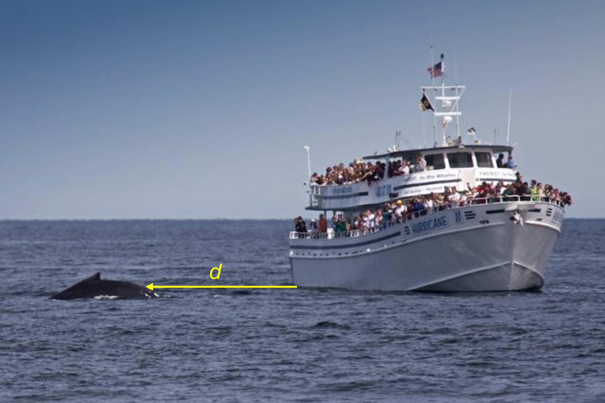{fig-align="center" width="398"}

## Thinned Point Process {.smaller}

::: {style="height: 50px;"}
:::

-   flexible approach that can include spatial covariates to model the mean intensity and a spatially structured random effect to account for unexplained heterogeneity not captured by the covariates.

-   to account for the imperfect detection of points we specify a thinning probability function $$
    g(s) = \text{Prob}(\text{a point at s is detected}|\text{a point is at s})
    $$

-   key property -- an LGCP with intensity $\lambda(s)$ that thinned by a probability function $g(s)$, follows also a LGCP with intensity:

$$
\underbrace{\tilde{\lambda}(s)}_{\text{observed process}} = \underbrace{\lambda(s)}_{\text{true process}} \times \underbrace{g(s)}_{\text{thinning probability}}
$$


## Some revant papers about distance sampling

Tutorial on the [`inlabru` github](https://inlabru-org.github.io/inlabru/articles/2d_lgcp_distancesampling.html)


:::{style = "margin-top:2em;"}
:::

::: {style = "font-size: 0.7em;" .refs-subset data-keys="@martino2021integration"}
:::


## Modelling movement data

-   models can also be fitted to movement data in `inlabru`

-   sometimes locations treated as a point pattern, ignoring sequential nature of the data

-   model development is an area of active research

-   approaches include:

    -   discrete time step-selection processes and

    -   continuous time Langevin diffusion models

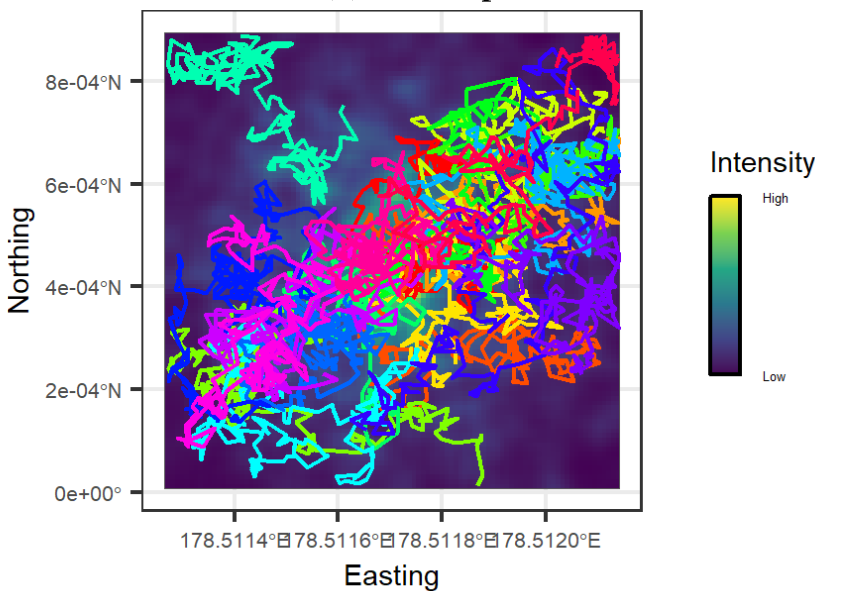{fig-align="center"}

## Some relevant papers about animal movement


:::{style = "margin-top:2em;"}
:::

::: {style = "font-size: 0.7em;" .refs-subset data-keys="@arce2023accounting @megan_thesis"}
:::


## Self exciting Hawks Processes{.smaller}


A self-exciting process is a point process in which the occurrence of an event increases the probability of further events occurring shortly afterwards. 

$$
\lambda(t)
=
\mu
+
\sum_{t_i<t}
g(t-t_i),
$$

where

- $\mu$ is a baseline event rate,
- each event $t_i$ temporarily increases the intensity $\lambda(t)$,
- the influence decays over time through $g(\cdot)$. 


**When are they used?:** Whenever events tend to occur in clusters:

- Earthquakes and aftershocks
- Wildfires
- Crime incidents
- Financial transactions
- Disease outbreaks
- Drought episodes 

## Self exciting Hawks Processes

Such processes can be implemented in `inlabru`...but it is not a plug and play code!


:::{style = "margin-top:2em;"}
:::

::: {style = "font-size: 0.7em;" .refs-subset data-keys="@serafini2023approximation
@naylor2023bayesian"}
:::


## Getting help with `INLA`/`inlabru` related topics

-   Discussion forum

    -   INLA [forum](https://groups.google.com/g/r-inla-discussion-group)
    -   inlabru [forum](https://github.com/inlabru-org/inlabru/discussions)

-   Please take contact if you have questions/problems to discuss :grinning:


## A small survey at the end


## References {.smaller data-title-offset="true"}

[@bakka2019non @cameletti2013spatio @bryce2022unified @fichera2023spatial @lamouroux2025addressing @lindgren2010explicit @lindgren2022spde @miller2020understanding @moraga2021bayesian @simpson2017  @panunzi2025estimating @belmont2024spatio @wu2026arealdisaggregationsmallarea @villejo2026spatiotemporalblockaggregationmodel @ingebrigtsen2014spatial @ingebrigtsen2015estimation @fuglstad2015exploring @fuglstad2015does @Fractional1 @Fractional2 @Lindgren_Bakka_Bolin_Krainski_Rue_2024 @lindgren2024inlabru @lilleborge2025joint@arce2023accounting
@megan_thesis @serafini2023approximation
@naylor2023bayesian @martino2021integration
@recachobayesian @bolin2026log]{style="display:none"}

::: {#refs}
:::


```{=html}
<script>
// 1. link each full-list entry to references.html (your existing code)
document.querySelectorAll('#refs [id^="ref-"]').forEach(function(entry) {
var a = document.createElement('a');
a.href = '../references.html#' + entry.id;
a.target = '_blank';
a.style.textDecoration = 'none';
a.style.color = 'inherit';
while (entry.firstChild) a.appendChild(entry.firstChild);
entry.appendChild(a);
});
// 2. copy chosen entries into each .refs-subset slide
var refs = document.getElementById('refs');
document.querySelectorAll('.refs-subset').forEach(function(box) {
box.className += ' ' + refs.className;
box.dataset.keys.split(/[\s,;]+/).forEach(function(k) {
k = k.replace(/^@/, '');
if (!k) return;
var src = document.getElementById('ref-' + k);
if (!src) { console.warn('refs-subset: no entry for ' + k); return; }
var copy = src.cloneNode(true);
copy.removeAttribute('id');
box.appendChild(copy);
});
});
</script>
```
